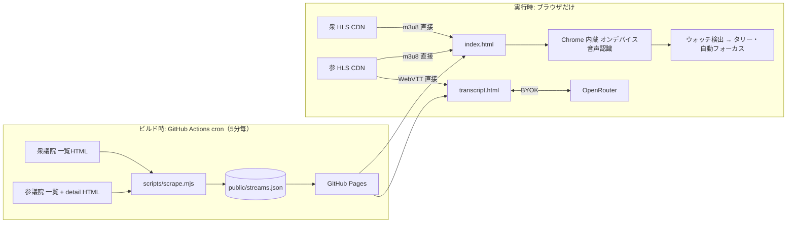
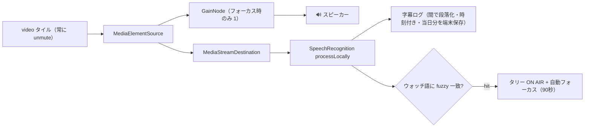
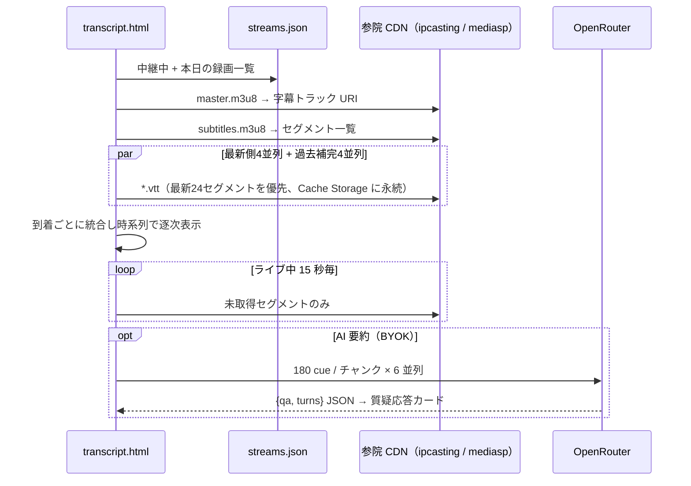

# shusantv

衆参の国会インターネット審議中継を **1画面に並べて同時監視** する非公式ビューア。
サーバー 0 台、**GitHub Pages + Actions だけ**で動く。

🔗 https://michitomo.github.io/shusantv/

## できること

| ページ | 機能 |
|---|---|
| `index.html` 中継グリッド | 開催中の全会議をタイル表示。クリックで音声 ON + 拡大。Chrome 内蔵の音声認識で字幕。**ウォッチ語**（議員名・会派）を検出するとタリーランプ点灯 + 自動フォーカス |
| `transcript.html` 文字起こし | 参議院の公式字幕（WebVTT）を全文表示・検索・TXT/VTT 保存。BYOK（OpenRouter）で質疑応答カード形式の AI 要約 |
| `asr-test.html` | オンデバイス音声認識の動作検証用 |

### 字幕ログ（サイドパネル）

映像上の字幕バブルは直近の数行だけを流します（スクロールしません）。読み返しはヘッダーの「字幕ログ」で開くサイドパネルで行います。狭い画面・縦長の画面では下段に出ます。

- 段落ごとに視聴した時刻（JST。中継の遅延を含む）を付けます。上へスクロールすると追尾を止め、新着段落数つきの「最新へ」で復帰します。
- 既定では音声を出している会議に追従します。セレクトで会議を固定すると、音声を切り替えずに別の会議を読めます。
- 当日分（JST）だけをこの端末の IndexedDB に保存し、リロードや配信URLの切替後も続きから読めます。前日以前の分は次回読み込み時に消去します。「消去」で表示中の会議の当日分を即時に消せます。外部には送信しません。IndexedDB が使えない環境ではページを開いている間だけ保持します。
- 「コピー」「保存」で、表示中のログを `[時:分:秒] 本文` 形式のテキストとして取り出せます。
- 同じ部屋で別の会議が始まったときは、会議名の区切りを入れます。
- 1会議あたり認識結果2万件までを保持します（終日の審議を想定した上限）。
- ASRの途中結果は上書きします。新しい本文が約1.5秒届かずに次の認識結果が来たら段落を分けます。ASRでは30字以上の段落が文末に達したとき、または確定した結果で200字以上になったときも、そこで段落を分けます。音声認識が語を空白で区切って返す場合は詰めて表示します。同じ途中結果への訂正・確定は段落を増やしません。認識の再起動やバッファ待ちで途中結果が確定しなかった場合も、表示済みの文は消さずに残します。
- 停止・バッファ待ち・シーク・認識再起動は発言の間として数えません。公式字幕は受信間隔でなく字幕の開始・終了時刻を使います。話者交代や実際の無音を判定する機能ではなく、認識遅延による誤分割・分割漏れはあります。
- 音声認識の対応環境は従来どおりです。非対応ブラウザでは参院の公式字幕のみ。画面幅への対応と実機の音声認識可否は別です。

### ASR段落のLLM校正（任意）

動画グリッドの「ASR校正」で方式を「OpenRouter（クラウド・BYOK）」に切り替えると、要約ページと共通のOpenRouter BYOK・モデル・プロバイダ設定を使えます。保存済みキーがあるだけでは送信せず、毎回「自動校正（全タイル）」をONにした後に確定する段落だけが対象です。公式VTT字幕や以前の字幕は送りません。

- 約1.5秒新しい本文がなく、途中結果が残っていないASR段落を1回送信します。話し続けている間も、文末（「。」「？」「！」、または「です」「ます」等で確定した文）に達し、段落が30字以上あればその時点で段落を閉じて送信します。短い相づちだけでは送らず、次の文とまとめます。文末でなくても、確定した認識結果で段落が200字以上になれば閉じます。停止・認識再起動だけでは確定しません。院・会議名・開催日は確認できた情報のみを使い、不明な情報や話者を推定させません。
- 校正案と元字幕を切り替えられます。元字幕は保持し、ウォッチ検出も元字幕を使います。過去を読んでいる間は表示を勝手に校正案へ切り替えません。校正案にも誤り・省略・創作があり得るため、必ず原文・音声と確認してください。
- 本文と会議情報をOpenRouter・モデル提供元へ送ります。キーはブラウザから固定のOpenRouter API宛てだけに使用し、校正処理はリダイレクトを拒否します。**段落ごとに料金が発生**し、表示額はAPIが返した金額のみです。未取得の料金は「不明」と表示し、取消・失敗時にも課金される可能性があります。
- 全タイルで同時1件、待機20件、1段落4,000字、45秒タイムアウト。失敗時は原文のまま、手動の再試行だけを許可します。OFF・設定変更・配信切替・タイル削除で該当処理を中止し、遅い応答は無視します。設定変更後は再度ONが必要です。

## アーキテクチャ



**ポイント**: 公式の会議名・会議一覧は Actions でスクレイピングする。開始直後の検知はブラウザから各院 CDN に直接問い合わせる。参院は既知チャンネルの公開メタデータを利用し、まだ公式一覧にない会議は「会議名確認中」で表示する。

## なぜ静的 Web で動くのか

| やりたいこと | 普通のやり方 | shusantv の工夫 |
|---|---|---|
| 開催中の会議一覧 | サーバーで常時スクレイピング | Actions cron（平日 8:47〜18:57 JST, 約5分毎）がスクレイピング → `streams.json` を焼いて Pages にデプロイ |
| cron の隙間（開始直後）を拾う | — | 衆院は `room00〜18` の m3u8、参院は既知チャンネルの `channel-info.json` を CORS で直接確認。参院は会議 ID の連番探索ではない |
| 映像再生 | プロキシ / 再配信 | 両院 CDN が CORS 開放なので hls.js で直接再生。フォーカス以外は最低画質、帯域に余裕があれば全部 HD |
| 字幕 | 音声認識サーバー | Chrome の `SpeechRecognition` を `processLocally` で動かしブラウザ内認識。無料・遅延小。非対応ブラウザ（Safari 等）は参議院タイルだけ公式字幕（WebVTT）で代替 |
| 文字起こし | バックエンドで字幕収集 | 参議院 HLS の字幕（WebVTT）を最新側から取得し逐次表示。標準8並列、Cache Storage で永続キャッシュ |
| AI 要約 | API キーをサーバーで保持 | BYOK。キーは localStorage、ブラウザ → OpenRouter に直送 |
| 状態保存 | DB | localStorage（ウォッチリスト・鍵・要約キャッシュ） |
| cron の自動停止（60 日無コミットで止まる） | — | 平日朝の cron が `.github/schedule-keepalive` をコミットして活動にする。enable API は停止の解除だけで、カウントは戻らない |

## 会議一覧の自動更新・参院の早期検知

- 動画グリッドと文字起こしの両方で、表示中は約60秒ごとに一覧を再確認する。非表示タブでは一覧確認を止め、戻ったらすぐ再確認する。Actions の実行・配信には遅延があり、5分間隔の設定は更新時刻の保証ではない。
- 公式 HTML は CORS 非対応。参院の既知チャンネルにある `https://sangiin-live.live.ipcasting.jp/live/{channel_hash}.h/channel-info.json` は CORS 対応で、最新番組 ID・配信 hash・開始時刻・配信状態を取得できる。
- **HTTP 200だけで中継とは判定しない。** 公開状態、`output=active`、当日の開始時刻、2分以内のメタデータと映像タイムスタンプを確認し、ID 0・65535や不正な配信 hash を除外する。字幕がまだ有効でない検知結果は文字起こしの候補に出さない。
- 会議名は**同日の同じ会議ID**にだけ公式一覧から付ける。チャンネルと委員会の固定対応を推測しない。未確認なら「参院・会議名確認中 (sid…)」を表示する。
- 取得先を番組固有の hash に固定し、同じチャンネルが別会議に切り替わっても、選択中の文字起こしを混ぜない。プルダウン更新や録画移行では、選択中の字幕・要約・検索条件を消さない。
- 既知チャンネルは初期2件に加え、公式一覧から学習。Actions は前回公開 JSON のチャンネル集合も引き継ぎ、ブラウザは端末内にも保存する。最大32件・3並列・各6秒タイムアウト、失敗時は最大5分まで間隔を延ばす。既知集合にない新チャンネルは公式一覧の次回取得まで検知できない。
- メタデータが不正・取得失敗なら直前の有効情報を短時間維持する。明示的な停止や番組切替とは区別する。動画や字幕そのものを探索のためにダウンロードしない。

## 中継グリッドの中身


### 端末内での読みやすさ整形（Gemini Nano・任意）

「ASR校正」の方式の既定は「ブラウザ内蔵AI（Gemini Nano・端末内）」で、Chrome 内蔵のモデル（Prompt API）で字幕を読みやすく整えます。字幕は外部に送信せず、料金もかかりません。

- 目的は読みやすさです。句読点と改行を補い、「えー」「ま」などの言いよどみを削ります。発言者が替わったと読み取れる所（指名・名乗り・「以上です」の後）と話題の変わり目で改行します。誤変換の訂正は文脈から明らかなものに限ります。
- ページを開いただけではモデルをダウンロードしません。既定のままでも利用可否を問い合わせるだけで、「モデルをダウンロードして準備」を押して初めてダウンロードします（数GB）。ダウンロード済みなら、「自動校正」のON/OFFは次回も引き継ぎます（ONのまま閉じれば次回もONで始まります。モデルが未ダウンロードの場合は自動ではダウンロードしません）。OpenRouter方式は課金と外部送信があるため、従来どおり毎回手動でONにします。
- 対象は字幕ログに表示中の会議だけです（端末の負荷を抑えるため）。表示する会議を切り替えると、待機中の整形は取り消します。
- 長い段落は数文ずつに分けて整形します。出力の文字数が原文から大きく増減した場合（要約や創作の疑い）は採用せず、原文のままにします。
- 小型モデルのため、言い換え・脱落・誤った改行は起こり得ます。発言者の判定は文面からの推測で、確実ではありません。元字幕といつでも切り替えられ、ウォッチ検出は元字幕を使います。
- 利用条件は Chrome の内蔵AIに従います（日本語は Chrome 149 以降、空き容量 22GB 以上、VRAM 4GB 超または RAM 16GB 以上が目安）。

### 音声の分岐と検出

Chrome では muted な video の音声キャプチャが無音になるため、video は常に unmute し WebAudio で分岐する。



- ウォッチ語はコンテキストバイアシング（`SpeechRecognitionPhrase`）で認識エンジンの優先語彙にも渡す
- 一致判定はカナ→かな正規化 + `|` 別名 + 編集距離 1 を許容

### レイアウトと画質

| 状態 | レイアウト | 画質 |
|---|---|---|
| 通常 | 画面を敷き詰めるグリッド（セル比 4:3〜16:9） | 全タイル最低ビットレート |
| フォーカス中 | 横画面: 左にメイン + 右サイドバー / 縦画面: 上にメイン + 下段 | メインのみ最高、他は最低 |
| 帯域が必要量の 2 倍超 | 同上 | 全タイル最高 |

hls.js は `liveSyncDurationCount: 1` など低遅延寄りに調整し、遅れたら最大 1.15 倍速でライブエッジに追従する。

## 文字起こしの流れ



最新24セグメントを優先し、最初の最新分が届くと過去側の補完を開始する。全履歴の取得完了を待たず、到着した字幕を約50ms単位で時系列に反映する。最新側と過去側の取得枠を分け、遅い過去分が新着の取得を塞がないようにする。標準は4+4並列（`?conc=N`で2〜16の範囲に変更可能）。

追尾ONのライブは最下部を維持し、追尾OFFでは読んでいる字幕行を基準にスクロール位置を保つ。会議を切り替えると前の取得を中止し、遅れて届いた字幕を混ぜない。失敗セグメントは12秒タイムアウト、最大3回試行（録画も独立して再試行）。ライブは次のプレイリスト確認でも再挑戦する。

取得途中や欠落がある場合は件数を表示し、書き出し名に「取得済み部分」、要約にも部分取得の表示を付ける。要約はクリック時の字幕スナップショットを使い、同じ件数でも内容が違えばキャッシュを分ける。要約中の重複リクエストは抑止する。

要約は LLM に本文を書き換えさせず、**質疑の区切り index と要旨だけ**を返させる。質問 / 答弁の役割付けは発言者名からクライアント側で推定し、出力トークンを抑える。

## ファイル構成

```
public/                      ← そのまま Pages にデプロイ
  index.html                 中継グリッド
  transcript.html            文字起こし・AI 要約
  transcript-loader.js       最新優先の取得キュー・時系列統合
  sangiin-discovery.js        参院CDNの早期検知・一覧統合
  caption-history.js          視聴中字幕の途中結果・段落・認識再起動管理
  caption-store.js            字幕ログの当日分の端末内保存（IndexedDB）
  nano.js                     端末内（Gemini Nano）での読みやすさ整形
  caption-view.js             字幕バブルと字幕ログの表示・追尾・校正案と原文の切替
  openrouter.js               共有BYOK設定・段落校正キュー
  asr-test.html              音声認識の検証
  streams.json               Actions が生成（gitignore）
lib/scrape.mjs               衆参スクレイパ（Actions と server.js で共用）
scripts/scrape.mjs           streams.json を書き出す（Actions 用）
scripts/llm-*.mjs            要約プロンプト・コスト計測の PoC
server.js                    ローカル用（スクレイプ + 静的配信 + デモ）
.github/workflows/pages.yml  cron → scrape → deploy
```

### `streams.json` の形

```jsonc
{
  "updatedAt": "2026-10-23T01:05:00.000Z",
  "sessionDate": "2026-10-23",
  "streams": [
    { "house": "shugiin", "id": "room01", "name": "予算委員会", "time": "9:00", "m3u8": "https://hlslive.shugiintv.go.jp/room01/amlst:room01/playlist.m3u8" },
    { "house": "sangiin", "id": "sid1234", "name": "厚生労働委員会", "time": "10:00", "pending": false, "m3u8": "...", "channelInfo": "..." }
  ],
  "vod": [ { "house": "sangiin", "id": "sid1230", "name": "内閣委員会", "hash": "..." } ],
  "errors": []
}
```

## ローカル開発

```sh
node server.js      # http://localhost:8787（streams.json はリクエスト時に生成・60 秒キャッシュ）
```

審議がない時間帯は `?demo=1`（〜`?demo=18`）で公開テスト HLS をダミー中継として並べられる。

### テスト

```sh
node --test lib/*.test.mjs
```

UI 回帰テストは fixture とシナリオを共用する。DOM モードはスクロール・要約・字幕ログ（サイドパネル・保存/復元/消去）・ASR/VTTライフサイクル・BYOK校正の同意/取消/再試行も検証し、Chromium モードは一覧・選択・動画タイルを検証する。外部通信・映像はモックし、実放送・音声認識・OpenRouter APIには接続せず、実キーも使わない。

```sh
npm install --no-save linkedom playwright
node scripts/test-ui.mjs
# Chromiumを別途用意。必要に応じて CHROMIUM_PATH を指定する
npx playwright install chromium
node scripts/test-ui.mjs --browser
```

## 制約・注意

- **音声認識による字幕は Chrome 139 以降限定**（オンデバイス `SpeechRecognition` と `SpeechRecognitionPhrase` が必要）。初回は日本語パックをダウンロードし、直後は Chrome の完全再起動が要ることがある
- **Safari 等の非対応ブラウザ**では WebAudio を使わず `video.muted` で音声を切り替え、字幕とウォッチ検出は参議院タイルの公式字幕のみで動く。WebKit は HLS 再生中の video を Web Audio に繋いでも GainNode が効かない（[WebKit Bug 180696](https://bugs.webkit.org/show_bug.cgi?id=180696)）ため
- 文字起こし・AI 要約は **参議院のみ**（公式字幕があるのは 2024 年 8 月以降の中継）
- 映像・字幕の著作権は各議院に帰属。本サイトは非公式の個人用ビューアで、字幕付き映像・字幕の転載は禁止されている
