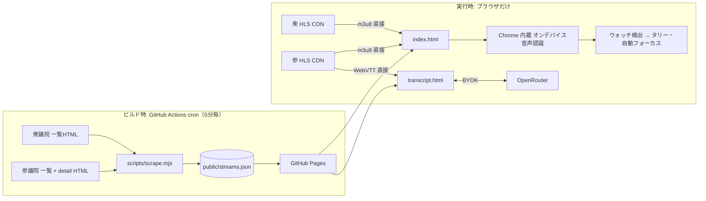
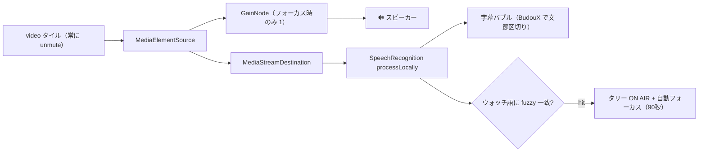
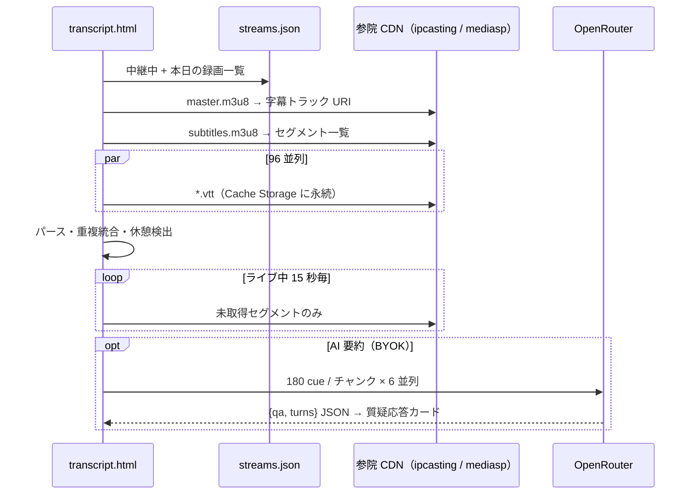

# shusantv

衆参の国会インターネット審議中継を **1画面に並べて同時監視** する非公式ビューア。
サーバー 0 台、**GitHub Pages + Actions だけ**で動く。

🔗 https://michitomo.github.io/shusantv/

## できること

| ページ | 機能 |
|---|---|
| `index.html` 中継グリッド | 開催中の全会議をタイル表示。クリックで音声 ON + 拡大。Chrome 内蔵の音声認識で字幕。**ウォッチ語**（議員名・会派）を検出するとタリーランプ点灯 + 自動フォーカス |
| `transcript.html` 文字起こし | 参議院の公式字幕（WebVTT）を全文表示・検索・TXT/VTT 保存。BYOK（OpenRouter）で質疑応答カード形式の AI 要約 |
| `asr-test.html` | オンデバイス音声認識の動作検証用 |

## アーキテクチャ



**ポイント**: サーバーが要る処理は「一覧のスクレイピング」だけ。それを Actions の cron に押し込み、残りは全部ブラウザと各院 CDN の直接通信で済ませている。

## なぜ静的 Web で動くのか

| やりたいこと | 普通のやり方 | shusantv の工夫 |
|---|---|---|
| 開催中の会議一覧 | サーバーで常時スクレイピング | Actions cron（平日 8:45〜18:55 JST, 5 分毎）がスクレイピング → `streams.json` を焼いて Pages にデプロイ |
| cron の隙間（開始直後）を拾う | — | 衆議院の m3u8 は CORS 開放なので、ブラウザから `room00〜18` を直接プローブ |
| 映像再生 | プロキシ / 再配信 | 両院 CDN が CORS 開放なので hls.js で直接再生。フォーカス以外は最低画質、帯域に余裕があれば全部 HD |
| 字幕 | 音声認識サーバー | Chrome の `SpeechRecognition` を `processLocally` で動かしブラウザ内認識。無料・遅延小 |
| 文字起こし | バックエンドで字幕収集 | 参議院 HLS の字幕トラック（WebVTT）を 96 並列で直接取得。Cache Storage で永続キャッシュ |
| AI 要約 | API キーをサーバーで保持 | BYOK。キーは localStorage、ブラウザ → OpenRouter に直送 |
| 状態保存 | DB | localStorage（ウォッチリスト・鍵・要約キャッシュ） |
| cron の自動停止（60 日無コミットで止まる） | — | 平日朝の cron で `workflows/enable` API を叩いて無活動カウンタをリセット |

## 中継グリッドの中身

### 音声の分岐と検出

Chrome では muted な video の音声キャプチャが無音になるため、video は常に unmute し WebAudio で分岐する。



- ウォッチ語はコンテキストバイアシング（`SpeechRecognitionPhrase`）で認識エンジンの優先語彙にも渡す
- 一致判定はカナ→かな正規化 + `|` 別名 + 編集距離 1 を許容

### レイアウトと画質

| 状態 | レイアウト | 画質 |
|---|---|---|
| 通常 | 画面を敷き詰めるグリッド（セル比 4:3〜16:9） | 全タイル最低ビットレート |
| フォーカス中 | 横画面: 左にメイン + 右サイドバー / 縦画面: 上にメイン + 下段 | メインのみ最高、他は最低 |
| 帯域が必要量の 2 倍超 | 同上 | 全タイル最高 |

hls.js は `liveSyncDurationCount: 1` など低遅延寄りに調整し、遅れたら最大 1.15 倍速でライブエッジに追従する。

## 文字起こしの流れ



要約は LLM に本文を書き換えさせず、**質疑の区切り index と要旨だけ**を返させる。質問 / 答弁の役割付けは発言者名からクライアント側で推定し、出力トークンを抑える。

## ファイル構成

```
public/                      ← そのまま Pages にデプロイ
  index.html                 中継グリッド
  transcript.html            文字起こし・AI 要約
  asr-test.html              音声認識の検証
  streams.json               Actions が生成（gitignore）
lib/scrape.mjs               衆参スクレイパ（Actions と server.js で共用）
scripts/scrape.mjs           streams.json を書き出す（Actions 用）
scripts/llm-*.mjs            要約プロンプト・コスト計測の PoC
server.js                    ローカル用（スクレイプ + 静的配信 + デモ）
.github/workflows/pages.yml  cron → scrape → deploy
```

### `streams.json` の形

```jsonc
{
  "updatedAt": "2026-10-23T01:05:00.000Z",
  "streams": [
    { "house": "shugiin", "id": "room01", "name": "予算委員会", "time": "9:00", "m3u8": "https://hlslive.shugiintv.go.jp/room01/amlst:room01/playlist.m3u8" },
    { "house": "sangiin", "id": "sid1234", "name": "厚生労働委員会", "time": "10:00", "pending": false, "m3u8": "...", "channelInfo": "..." }
  ],
  "vod": [ { "house": "sangiin", "id": "sid1230", "name": "内閣委員会", "hash": "..." } ],
  "errors": []
}
```

## ローカル開発

```sh
node server.js      # http://localhost:8787（streams.json はリクエスト時に生成・60 秒キャッシュ）
```

審議がない時間帯は `?demo=1`（〜`?demo=18`）で公開テスト HLS をダミー中継として並べられる。

## 制約・注意

- **字幕・ウォッチ検出は Chrome 限定**（オンデバイス `SpeechRecognition` と `SpeechRecognitionPhrase` が必要）。初回は日本語パックをダウンロードし、直後は Chrome の完全再起動が要ることがある
- 文字起こし・AI 要約は **参議院のみ**（公式字幕があるのは 2024 年 8 月以降の中継）
- 映像・字幕の著作権は各議院に帰属。本サイトは非公式の個人用ビューアで、字幕付き映像・字幕の転載は禁止されている
